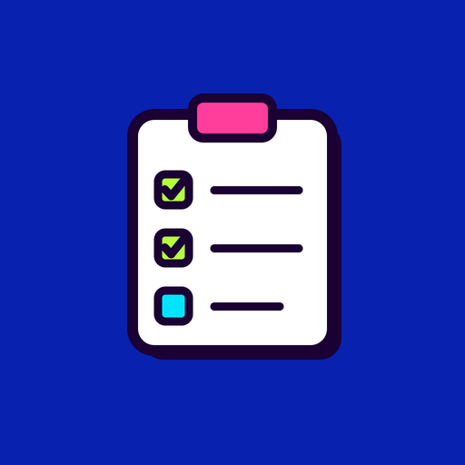
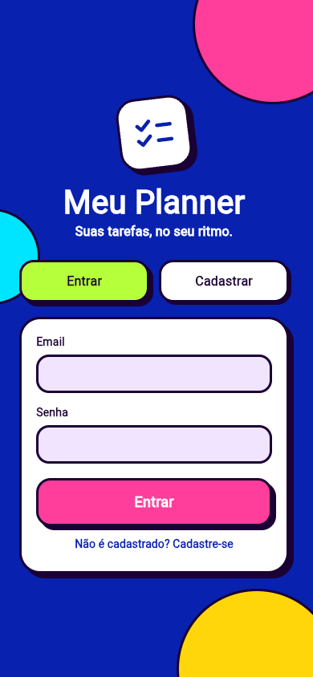
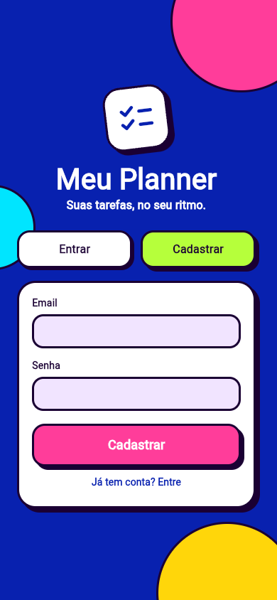
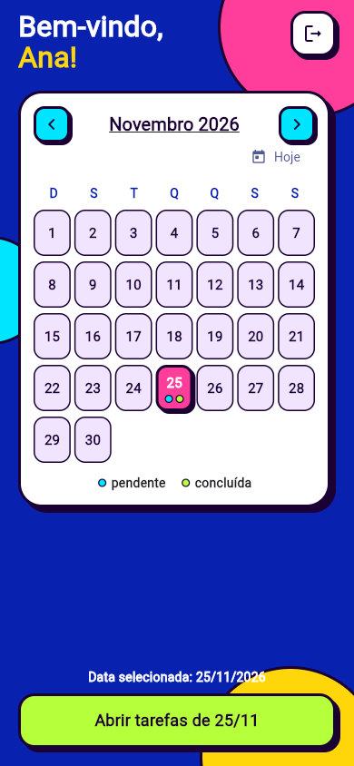
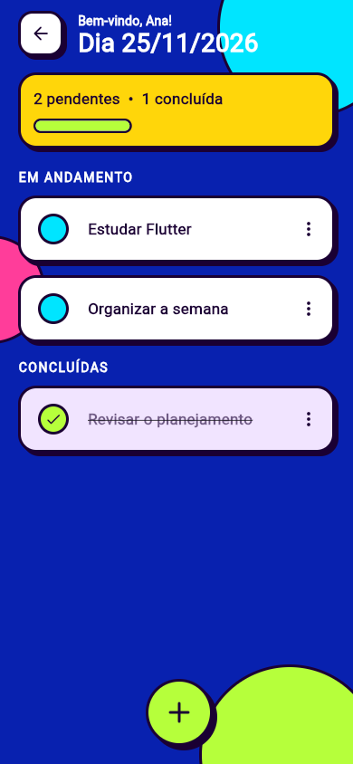
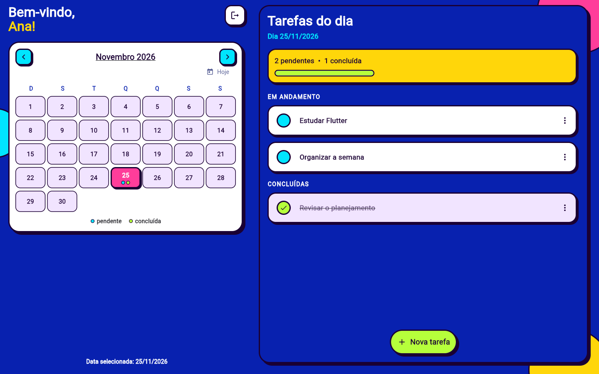

# Meu Planner



**Suas tarefas, no seu ritmo.**

App Flutter para organizar tarefas por dia, com calendário, login e cadastro. A interface é em português do Brasil, no estilo neo-brutalista, e funciona no celular, na web e no desktop.


> **Projeto de demonstração:** contas e tarefas ficam **em memória**. Ao fechar ou recarregar o app, os dados são apagados. Não há backend nem Firebase.

## Funcionalidades

- **Cadastro e login** com validação de e-mail e senha. Cada usuário vê só as próprias tarefas.
- **Calendário mensal** com escolha de mês e ano, botão **Hoje** e marcadores de tarefas pendentes e concluídas em cada dia.
- **Tarefas por dia:** criar, editar, concluir e transferir para outra data.
- **Excluir** pelo menu ou arrastando para o lado, com opção de **DESFAZER**.
- **Ordenação automática:** pendentes primeiro, depois as concluídas, em ordem alfabética (respeitando acentos).
- **Layout responsivo:** calendário e tarefas lado a lado em telas largas, e uma coluna no celular.
- **Acessibilidade:**
  - navegação completa pelo teclado (Tab, Enter, Espaço)
  - foco visível
  - descrições para leitores de tela
  - suporte a texto ampliado até 200%

## Capturas de tela

| Login | Cadastro | Calendário | Tarefas |
| --- | --- | --- | --- |
|  |  |  |  |

**No computador:**



<!-- Para atualizar os prints, substitua os arquivos em docs/images/ mantendo os mesmos nomes. -->

## Tecnologias

- **[Flutter](https://flutter.dev) 3.47** e **Dart 3.13**, com Material 3
- **Gerenciamento de estado** com `ChangeNotifier` e `ListenableBuilder`, sem pacotes externos
- **[crypto](https://pub.dev/packages/crypto)** para guardar as senhas como hash SHA-256 com salt
- **`flutter_localizations`** para datas e textos em pt-BR
- **`flutter_test`**, com testes de unidade e de widget
- **GitHub Actions**, com análise e testes automáticos a cada push

> **Sobre a senha:** o hash SHA-256 com salt aleatório é suficiente para esta demonstração em memória. Em um app com banco de dados real, eu usaria um algoritmo feito para senhas, como **bcrypt** ou **argon2**.

## Como rodar

**Pré-requisitos:**
- [Flutter 3.47](https://docs.flutter.dev/get-started/install) ou mais recente (inclui o Dart)
- um navegador, emulador Android ou o desktop configurado

Para conferir o ambiente, rode `flutter doctor`.

```bash
git clone https://github.com/Suiany-Xavier/meu_planner.git
cd meu_planner
flutter pub get
flutter run            # escolhe o dispositivo disponível
flutter run -d chrome  # ou direto no navegador
```

No primeiro uso, toque em **Cadastrar** e crie uma conta com um e-mail fictício e uma senha de pelo menos 6 caracteres. Depois, entre com esses dados.

### Testes

```bash
flutter analyze
flutter test
```

Se a máquina tiver pouca memória, use `flutter test -j 2`.

## Estrutura de pastas

```text
meu_planner/
├── lib/
│   ├── main.dart                  # MeuPlannerApp: tema, idioma e troca login ↔ calendário
│   ├── models/task.dart           # Modelo imutável de tarefa
│   ├── services/auth_service.dart # Cadastro, login e logout (senha em hash)
│   ├── stores/task_store.dart     # Tarefas por usuário e dia, e ordenação
│   ├── screens/                   # Login, calendário, tarefas e diálogo de tarefa
│   ├── widgets.dart               # Componentes visuais e acessíveis reutilizáveis
│   ├── theme.dart                 # Cores (AppColors), textos (AppText) e tema
│   └── utils.dart                 # Formatação e comparação de datas
├── test/                          # Testes de regras, fluxos e acessibilidade
├── assets/branding/               # Ícone do app (SVG original e PNG)
├── tool/generate_icons.py         # Gera os ícones de todas as plataformas a partir do SVG
├── docs/                          # Guias de manutenção e distribuição, e capturas de tela
├── android/ ios/ web/ linux/ macos/ windows/
└── .github/workflows/flutter.yml  # Integração contínua
```

Os detalhes técnicos (arquitetura, rotina de testes e diagnóstico) estão em [docs/MANUTENCAO.md](docs/MANUTENCAO.md). Builds, assinatura e ícones estão em [docs/DISTRIBUICAO.md](docs/DISTRIBUICAO.md).

## Próximos passos

- [ ] Salvar contas e tarefas no aparelho (persistência local)
- [ ] Manter a sessão aberta ao reabrir o app
- [ ] Recuperação de senha
- [ ] Testar em aparelhos reais e com leitores de tela

## Licença

Distribuído sob a licença MIT. Veja [LICENSE](LICENSE).

## Contato

Feito por **Suiany Xavier**, estudante de Análise e Desenvolvimento de Sistemas.

[](https://github.com/Suiany-Xavier)
[](https://www.linkedin.com/in/suiany-xavier-b90668338/)

